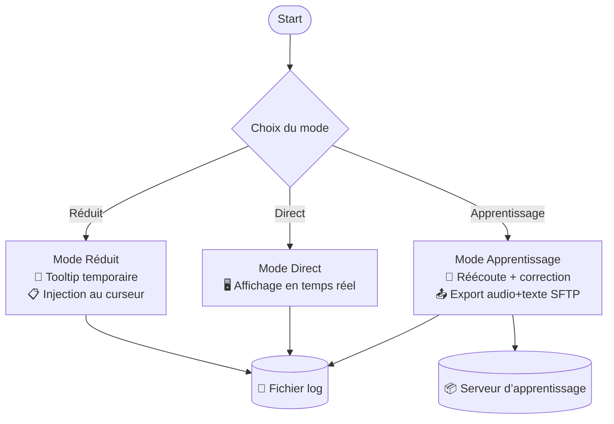
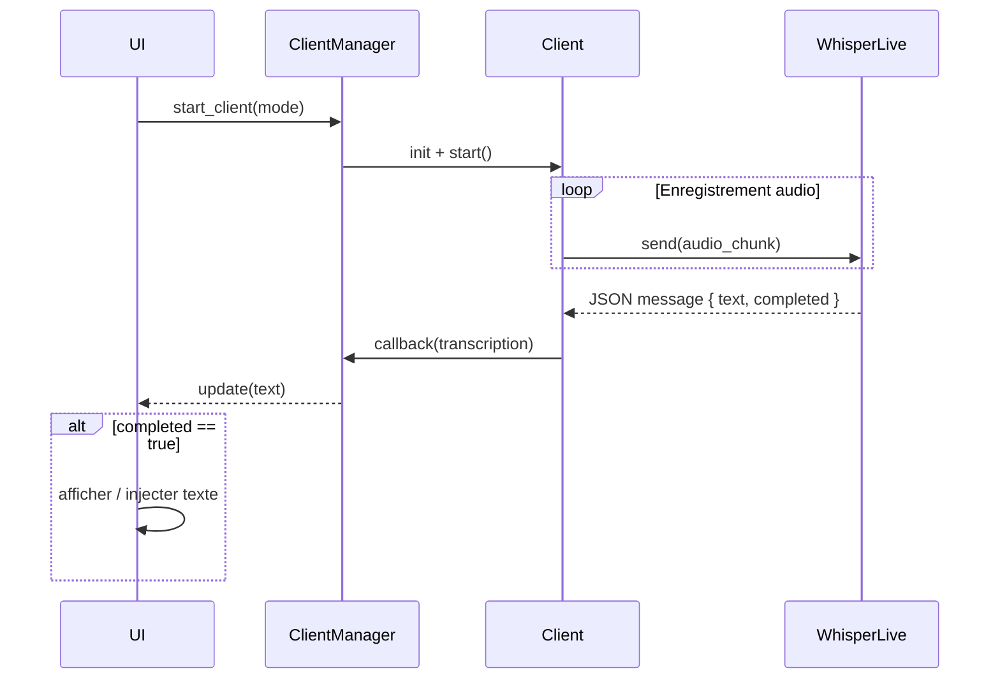
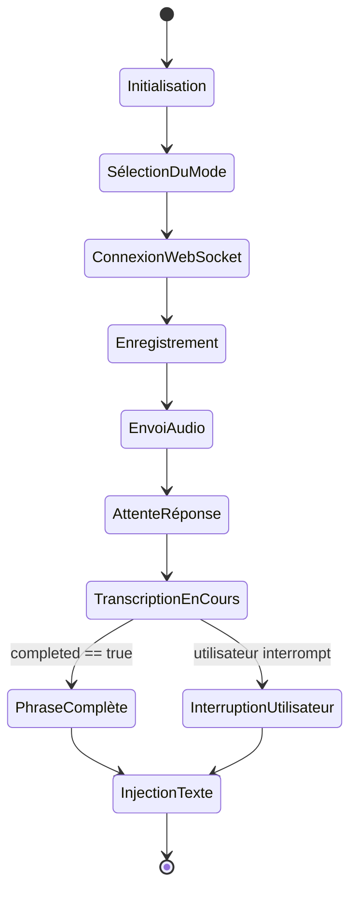
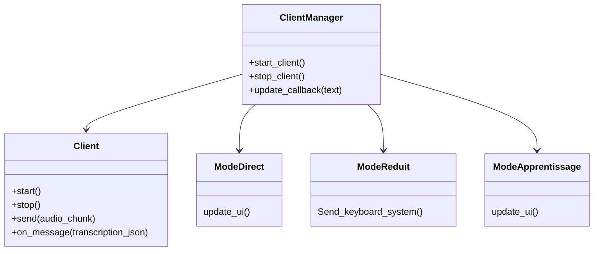

# 🧰 RecoVocale – Guide Développeur

## 🎯 Objectif

Ce paragraphe sert de référence pour toute personne souhaitant comprendre, maintenir, ou réimplémenter le logiciel **RecoVocale** dans un autre langage ou un nouveau contexte technique.

---

## 🧭 Vue d'ensemble

- **But** : Transcription vocale en temps réel pour personnel médical via serveur WhisperLive
- **Langage actuel** : Python (compilé pour Windows)
- **Architecture** :
  - Client WebSocket audio → Serveur WhisperLive
  - Réception des transcriptions en callback
  - Modes de fonctionnement variés selon l'interface et l’usage

---

## 📦 Composants principaux

| Composant       | Rôle                                                         |
| --------------- | ------------------------------------------------------------ |
| `Client`        | Capture micro, envoi audio, réception transcription          |
| `ClientManager` | Gère les modes, callbacks, boucle de vie client              |
| `Mode_*`        | Modes d'utilisation (direct, réduit, apprentissage)          |
| `Correcteur`    | Nettoie et ajuste la transcription reçue                     |
| `ToolTip`       | Affiche le texte temporairement dans une bulle (mode réduit) |
| `insertions`    | Gère les textes préremplis appelés par commande vocale       |

---

## 🧩 Fonctionnement global

### Flux audio → transcription

1. Micro actif → flux en chunks
2. WebSocket client : envoi au serveur WhisperLive
3. Réception asynchrone des messages JSON
4. Callback appelé à chaque message
5. Construction incrémentale de la phrase
6. À `"completed": true`, la phrase est validée et injectée (UI ou curseur)

### Exemple de message WebSocket reçu

```json
{
  "uid": "abc123",
  "segments": [
    {
      "start": "0.000",
      "end": "2.780",
      "text": "Bonjour madame Dupont, comment allez-vous aujourd'hui ?",
      "completed": true
    }
  ]
}
```

- `uid` : identifiant unique du client
- `segments[]` : liste de segments textuels transcrits
- `start` / `end` : timecode du segment audio correspondant
- `text` : transcription brute du segment
- `completed` : `true` indique une phrase terminée (peut être injectée dans l'interface)

- `text` : transcription brute envoyée par le serveur
- `is_final` : indique si ce fragment remplace les précédents
- `completed` : indique que la phrase est terminée (déclenche injection dans l'UI)

### Modes




#### Mode direct

- Texte affiché en direct dans une fenêtre dédiée

#### Mode réduit

- Tooltip temporaire avec transcription
- À la fin : injection dans curseur système

#### Mode apprentissage

- Stocke l'audio et la transcription
- Envoi via SFTP vers serveur d’apprentissage

---

## 🧠 Spécificités à réimplémenter

- Push-to-talk (SpeechMike USB)
- Configurable via `micro_actions_config.json`
- Insertions dynamiques (ex : "insérer signature")
- Correction automatique : unités, chiffres, ponctuation
- Système de logs, config utilisateur (`config.ini`)

---

## 🔐 Communication réseau

- WebSocket client vers WhisperLive (texte ou JSON)
- Upload SFTP avec identifiants (mode apprentissage)

---

## 📁 Fichiers importants

- `config.ini` : préférences utilisateur
- `micro_actions_config.json` : configuration des touches micro USB
- `logs/` : fichiers journaux
- `insertions/` : répertoire des textes personnalisés

---

## 📊 Diagramme de séquence – Flux WebSocket



## 🔁 Cycle de vie d'une session complète



## 🧪 Tests et validation

- Vérification du flux complet (micro > texte > UI)
- Simulations de phrase incomplète / complète
- Tests des raccourcis / insertions / tooltips

---

## 📐 Diagramme UML simplifié



---

## 🚀 Objectifs de réécriture

- Reproduire les comportements clés avec une base solide
- Découpler l’interface du cœur logique (si besoin)
- Prévoir un système extensible (plugins d’action, nouveaux modes)

