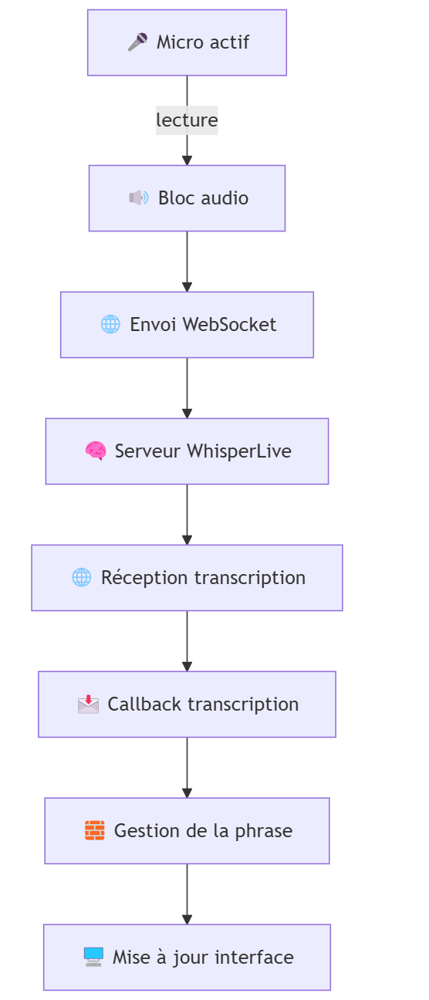
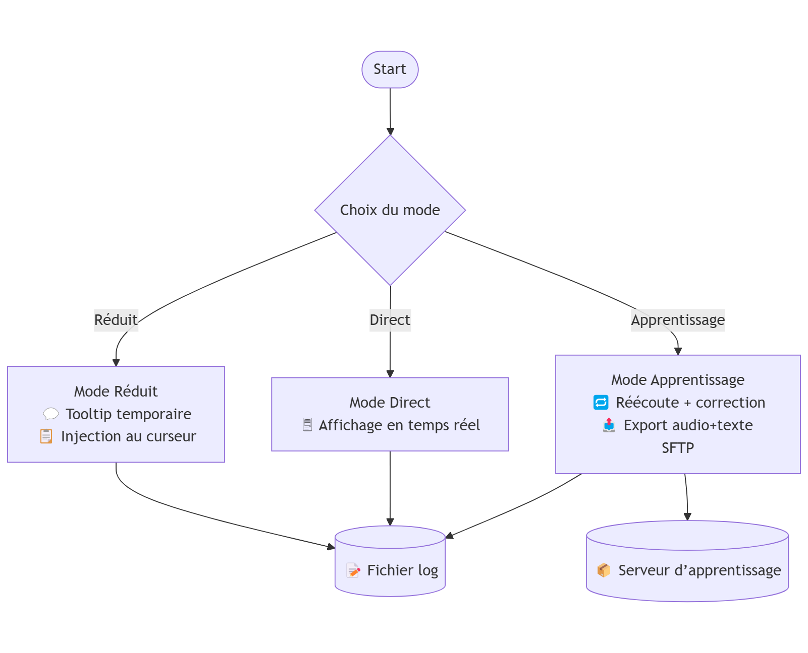
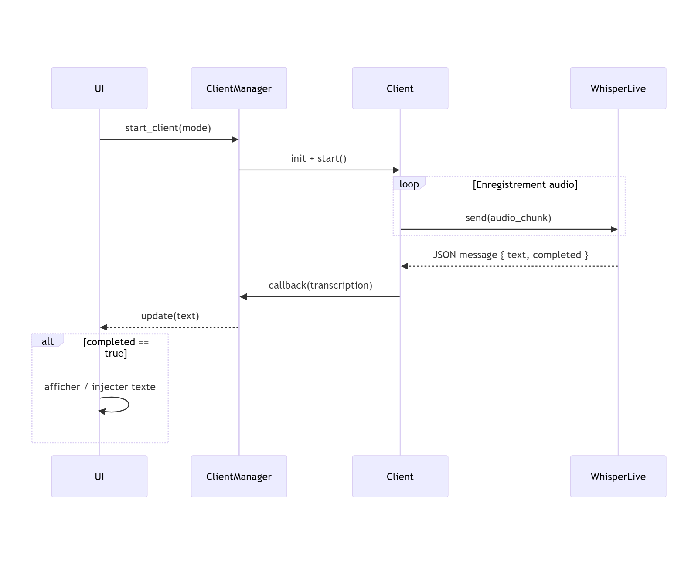
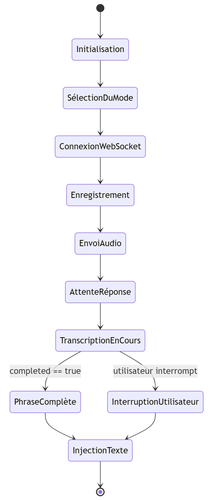
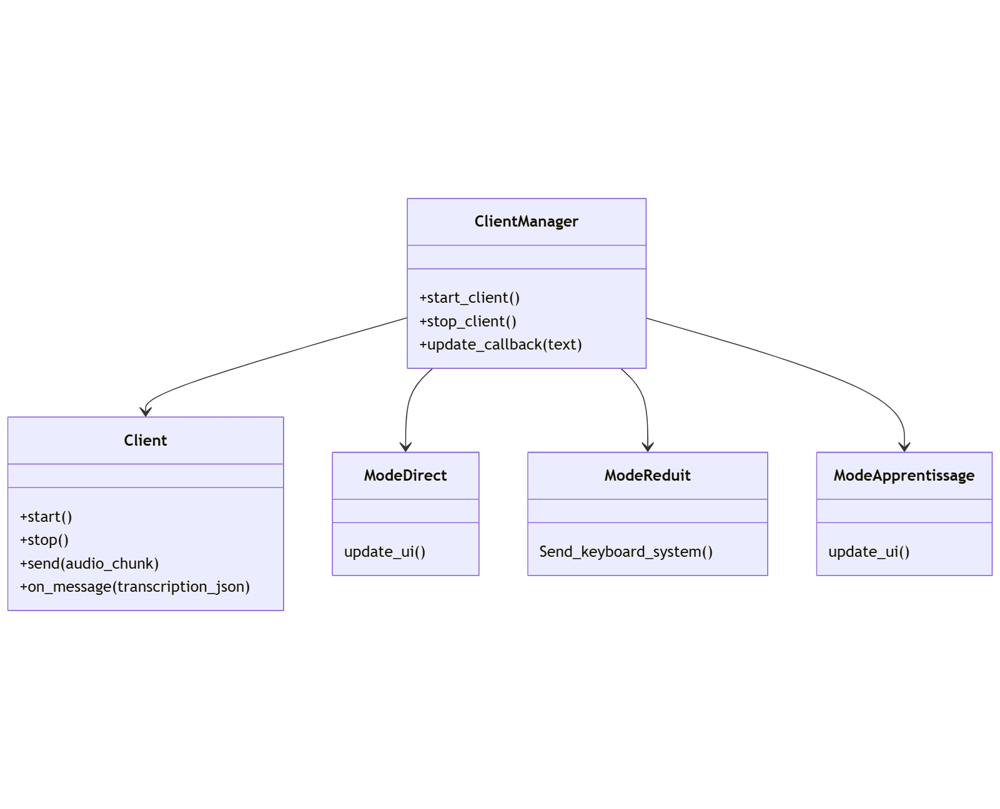

# 🧭 RecoVocale
## 📑 Sommaire
<!-- TOC -->
<!-- TOCstop -->
- [🧭 RecoVocale](#-recovocale)
  - [📑 Sommaire](#-sommaire)
    - [🎯 Objectif du logiciel](#-objectif-du-logiciel)
  - [🏗️ Fonctionnalités principales](#️-fonctionnalités-principales)
  - [🛠️ Technologies et architecture](#️-technologies-et-architecture)
    - [⚙️ Point d’entrée du programme](#️-point-dentrée-du-programme)
- [🧩 2. Structure des modules](#-2-structure-des-modules)
  - [Aperçu général](#aperçu-général)
    - [📌 Modules principaux](#-modules-principaux)
    - [🧩 Modules secondaires](#-modules-secondaires)
  - [📁 Détail par module](#-détail-par-module)
    - [📌 Modules principaux](#-modules-principaux-1)
    - [`RecoVocale`](#recovocale)
    - [`Mode`](#mode)
    - [`Mode_Direct`](#mode_direct)
    - [`Mode_Reduit`](#mode_reduit)
    - [`Mode_Apprentissage`](#mode_apprentissage)
    - [`client`](#client)
    - [`ClientManager`](#clientmanager)
    - [🧩 Modules secondaires](#-modules-secondaires-1)
    - [`Actions`](#actions)
    - [`Correcteur`](#correcteur)
    - [`fenetre_debug`](#fenetre_debug)
    - [`ftp_upload` / `sftp_upload`](#ftp_upload--sftp_upload)
    - [`info`](#info)
    - [`insertions`](#insertions)
    - [`loger`](#loger)
    - [`Micro`](#micro)
    - [`shortcut_manager`](#shortcut_manager)
    - [`ToolTip`](#tooltip)
    - [`Transcription`](#transcription)
    - [`unite`](#unite)
    - [`UserConfig`](#userconfig)
    - [`utils`](#utils)
    - [`utils_keyboard`](#utils_keyboard)
    - [`utils_socket`](#utils_socket)
    - [`utils_window`](#utils_window)
- [🔄 3. Algorithmes et flux de traitement](#-3-algorithmes-et-flux-de-traitement)
  - [🎙️ Micro → Serveur WhisperLive → Transcription](#️-micro--serveur-whisperlive--transcription)
    - [📤 1. Capture et envoi du flux audio](#-1-capture-et-envoi-du-flux-audio)
    - [🔄 2. Réception et traitement de la transcription](#-2-réception-et-traitement-de-la-transcription)
  - [🖥️ Mode Direct vs Mode Réduit](#️-mode-direct-vs-mode-réduit)
    - [🪟 Mode Direct](#-mode-direct)
    - [📋 Mode Réduit](#-mode-réduit)
  - [🎓 Mode Apprentissage](#-mode-apprentissage)
  - [📂 Transcription de fichiers audio](#-transcription-de-fichiers-audio)
  - [🧠 Commandes vocales intelligentes](#-commandes-vocales-intelligentes)
  - [🔌 Choix du service médical](#-choix-du-service-médical)
- [🖱️ 4. Interface utilisateur et options disponibles](#️-4-interface-utilisateur-et-options-disponibles)
  - [🪟 Fenêtre principale](#-fenêtre-principale)
    - [🎧 Mode direct](#-mode-direct-1)
    - [📋 Mode réduit](#-mode-réduit-1)
    - [🎓 Mode apprentissage](#-mode-apprentissage-1)
  - [📂 Glisser-déposer](#-glisser-déposer)
  - [🧠 Menus](#-menus)
    - [🏥 Menu "Service"](#-menu-service)
    - [✍️ Menu "Insertions"](#️-menu-insertions)
    - [🎓 Menu "Mode Apprentissage"](#-menu-mode-apprentissage)
    - [🔉 Menu "Audio après dépôt"](#-menu-audio-après-dépôt)
    - [⌨️ Menu "Raccourcis"](#️-menu-raccourcis)
    - [⚙️ Menu "Options"](#️-menu-options)
  - [🪟 Fenêtres annexes](#-fenêtres-annexes)
  - [⌨️ Raccourci clavier](#️-raccourci-clavier)
  - [🎤 Micros spéciaux (SpeechMike)](#-micros-spéciaux-speechmike)
    - [🔧 Configuration personnalisée (`micro_actions_config.json`)](#-configuration-personnalisée-micro_actions_configjson)
- [🧠 6. Algorithmes : Envoi audio, découpage, threads, callbacks](#-6-algorithmes--envoi-audio-découpage-threads-callbacks)
  - [🎙️ Classe `Client` (`client`)](#️-classe-client-client)
    - [🔄 Initialisation](#-initialisation)
  - [📤 Envoi audio en temps réel](#-envoi-audio-en-temps-réel)
  - [⏱️ Threads et écoute](#️-threads-et-écoute)
  - [📥 Réception des messages](#-réception-des-messages)
  - [🧩 Classe `ClientManager` (`ClientManager`)](#-classe-clientmanager-clientmanager)
    - [▶️ Méthode `start_client`](#️-méthode-start_client)
  - [📌 Gestion des callbacks](#-gestion-des-callbacks)
  - [🧬 Architecture audio → transcription → mise à jour](#-architecture-audio--transcription--mise-à-jour)
    - [🔁 Vue d'ensemble du flux](#-vue-densemble-du-flux)
    - [🧩 Étapes détaillées](#-étapes-détaillées)
      - [1. Enregistrement et envoi audio](#1-enregistrement-et-envoi-audio)
      - [2. Réception des transcriptions](#2-réception-des-transcriptions)
      - [3. Callback et gestion de la phrase](#3-callback-et-gestion-de-la-phrase)
      - [4. Mise à jour de l’interface](#4-mise-à-jour-de-linterface)
    - [🧠 Gestion des phrases terminées](#-gestion-des-phrases-terminées)
- [🧰 RecoVocale – Guide Développeur](#-recovocale--guide-développeur)
  - [🎯 Objectif](#-objectif)
  - [🧭 Vue d'ensemble](#-vue-densemble)
  - [📦 Composants principaux](#-composants-principaux)
  - [🧩 Fonctionnement global](#-fonctionnement-global)
    - [Flux audio → transcription](#flux-audio--transcription)
    - [Exemple de message WebSocket reçu](#exemple-de-message-websocket-reçu)
    - [Modes](#modes)
      - [Mode direct](#mode-direct)
      - [Mode réduit](#mode-réduit)
      - [Mode apprentissage](#mode-apprentissage)
  - [🧠 Spécificités à réimplémenter](#-spécificités-à-réimplémenter)
  - [🔐 Communication réseau](#-communication-réseau)
  - [📁 Fichiers importants](#-fichiers-importants)
  - [📊 Diagramme de séquence – Flux WebSocket](#-diagramme-de-séquence--flux-websocket)
  - [🔁 Cycle de vie d'une session complète](#-cycle-de-vie-dune-session-complète)
  - [🧪 Tests et validation](#-tests-et-validation)
  - [📐 Diagramme UML simplifié](#-diagramme-uml-simplifié)
  - [🚀 Objectifs de réécriture](#-objectifs-de-réécriture)

<div style="page-break-after: always;"></div>

### 🎯 Objectif du logiciel

**RecoVocale** est une application Windows développée en Python permettant de réaliser la **transcription vocale en temps réel**, à destination du **personnel médical** (médecins, infirmiers, secrétaires médicales). Elle repose sur un serveur **WhisperLive**, qui effectue l'inférence de transcription à partir d’un flux audio envoyé via WebSocket.

---

## 🏗️ Fonctionnalités principales

- 🎤 **Transcription en temps réel** de la voix captée par le micro
- 🔁 Communication **client/serveur via WebSocket** avec WhisperLive
- 🖥️ Deux **modes d'affichage** :
  - **Mode direct** : le texte transcrit est affiché dans une fenêtre en temps réel
  - **Mode réduit** : le texte est collé directement à l’emplacement du curseur (copier-coller automatique)
- 📚 **Mode apprentissage** :
  - Réécoute de l'audio
  - Envoi de la paire (audio, texte) sur un **serveur SFTP**
  - Objectif : entraînement de modèles Whisper personnalisés
- 📁 **Transcription de fichiers audio** par glisser-déposer dans l'interface
- 🏥 **Choix du service médical** (ex : Oncologie, Cardiologie, etc.) :
  - Permet de router le flux WebSocket vers un serveur dédié avec des **modèles spécialisés par service**
- 💬 **Commandes vocales "intelligentes"** :
  - Utilisation du mot-clé `"insérer"` suivi d’un mot-clé pour insérer un texte pré-rempli (ex : "insérer signature")
  - Ajout d’unités médicales, dates, chiffres romains, etc. automatiquement

---

## 🛠️ Technologies et architecture

- **Langage principal** : Python (compilé pour Windows)
- **Communication serveur** : WebSocket (WhisperLive)
- **Audio** : flux micro en temps réel + lecture/écriture fichiers audio
- **Correction** : système intégré de post-traitement (unités, chiffres, etc.)
- **Transferts** : support SFTP pour l'apprentissage
- **Interface** : application graphique Windows avec menus contextuels

---

### ⚙️ Point d’entrée du programme

L’entrée principale du logiciel est le fichier **`RecoVocale`**.  

<div style="page-break-after: always;"></div>

# 🧩 2. Structure des modules

## Aperçu général

### 📌 Modules principaux

| Fichier | Rôle principal |
|--------|----------------|
| `RecoVocale` | Point d’entrée principal de l’application |
| `Mode` | Classe de base pour les différents modes (direct, réduit, apprentissage) |
| `Mode_Direct` | Mode direct : transcription affichée en temps réel dans une fenêtre |
| `Mode_Reduit` | Mode réduit : texte injecté automatiquement au curseur |
| `Mode_Apprentissage` | Mode apprentissage : réécoute, correction, export vers SFTP |
| `client` | Communication WebSocket : envoi des blocs audio, réception des transcriptions |
| `ClientManager` | Coordination des composants : micro, modes, enregistrement, transcription |

---

### 🧩 Modules secondaires

| Fichier | Rôle principal |
|--------|----------------|
| `Actions` | Déclenchement d’actions dynamiques via commandes vocales |
| `Correcteur` | Correction automatique des transcriptions (unités, chiffres, dates…) |
| `fenetre_debug` | Interface de debug pour visualiser les logs |
| `ftp_upload` / `sftp_upload` | Envoi de fichiers audio/texte vers un serveur distant (FTP/SFTP) |
| `info` | Constantes globales : version, services, chemins |
| `insertions` | Gestion des insertions vocales personnalisées |
| `loger` | Journalisation structurée des événements et sessions |
| `Micro` | Détection, test et gestion des microphones |
| `Mode_Apprenti` | Ancienne version ou variante du mode apprentissage |
| `Mode_Record` | Mode d’enregistrement seul sans transcription |
| `shortcut_manager` | Gestion des raccourcis clavier utilisateurs |
| `ToolTip` | Affichage d’une bulle temporaire avec la transcription en cours (mode réduit) |
| `Transcription` | Construction et gestion du texte transcrit |
| `unite` | Remplacement intelligent des unités médicales |
| `UserConfig` | Configuration personnalisée sauvegardée utilisateur |
| `utils` | Fonctions utilitaires communes |
| `utils_keyboard` | Simulation de frappe clavier |
| `utils_socket` | Vérification de la disponibilité du serveur WebSocket |
| `utils_window` | Manipulation de fenêtres (position, topmost, etc.) |


---

## 📁 Détail par module

### 📌 Modules principaux

### `RecoVocale`
- 📌 **Point d’entrée principal**
- Initialise l’interface utilisateur
- Lance le mode actif (direct, réduit, apprentissage)
- Gère les menus : service, insertions, raccourcis, apprentissage

### `Mode`
- Définit une **classe de base commune** utilisée par tous les modes
- Gère les comportements partagés : état de transcription, affichage, géométrie des fenêtres

### `Mode_Direct`
- Affiche la transcription **en temps réel dans une fenêtre**

### `Mode_Reduit`
- Injecte automatiquement le texte transcrit **au curseur système**
- Adapté aux logiciels externes (ex : logiciels hospitaliers, Word etc...)

### `Mode_Apprentissage`
- Permet de **réécouter, corriger, et valider** une transcription
- Envoie la paire audio/texte sur un serveur via **SFTP** pour entraînement

### `client`
- Gère la **connexion WebSocket** avec le serveur WhisperLive
- Capture l’audio, le découpe, et l’envoie en continu
- Reçoit les transcriptions et appelle un **callback**

<div style="page-break-after: always;"></div>

### `ClientManager`
- Coordonne la logique centrale :
  - Création du client audio
  - Lancement des différents modes
  - Réception et transmission des transcriptions à l’interface
  - Appel des callbacks d’affichage ou d’envoi

---

### 🧩 Modules secondaires

### `Actions`
- Déclenche des actions pour les micros USB (SpeechMike etc...)
- Organise les actions en classes modulaires

### `Correcteur`
- Corrige la transcription : unités, chiffres romains, ponctuation, etc.

### `fenetre_debug`
- Outil de développement : redirige les logs dans une interface graphique

### `ftp_upload` / `sftp_upload`
- Envoient des fichiers audio/texte vers un serveur distant
- `sftp_upload` utilise un canal sécurisé (SFTP)

### `info`
- Contient des **constantes globales** : version, services disponibles, chemins

### `insertions`
- Gère les **textes insérables par commande vocale**
- Interface de création, édition, suppression

### `loger`
- Écrit les événements de session dans des fichiers de log
- Utilé pour les statistiques de transcription

### `Micro`
- Liste et teste les micros disponibles
- Fournit une interface pour capturer depuis un micro externe

### `shortcut_manager`
- Permet à l’utilisateur de personnaliser les raccourcis clavier (start/pause)

### `ToolTip`
- Affiche une **bulle flottante contenant la transcription en cours**
- Utilisé uniquement dans le **mode réduit**
- La bulle apparaît **tant que la transcription n’est pas terminée**
- Dès que la transcription est finalisée (ou interrompue), le texte est envoyé au **curseur système**

### `Transcription`
- Gère la construction incrémentale du texte transcrit
- Ajoute ou remplace dynamiquement le contenu affiché

### `unite`
- Transforme automatiquement les unités médicales en notation correcte (ex : “mg litre” → “mg/L”)

### `UserConfig`
- Lit et écrit le fichier `config.ini` utilisateur (ex : mode par défaut, position fenêtre)

### `utils`
- Fonctions génériques : manipulation de fichiers, formats, conversions

### `utils_keyboard`
- Simule des saisies clavier (copier/coller automatique, insertion de texte)

### `utils_socket`
- Vérifie l’état du serveur (ping WebSocket, test de disponibilité)

### `utils_window`
- Manipule les fenêtres (position, focus, toujours au-dessus, etc.)

<div style="page-break-after: always;"></div>

# 🔄 3. Algorithmes et flux de traitement

Ce chapitre décrit les principaux flux de données et logiques internes du logiciel RecoVocale, depuis la capture audio jusqu'à l’affichage ou l’envoi de la transcription.

---

## 🎙️ Micro → Serveur WhisperLive → Transcription

### 📤 1. Capture et envoi du flux audio

- Activation du **microphone**
- Envoi en **temps réel** via WebSocket au serveur WhisperLive
- Flux découpé en blocs (chunks) audio
- Bufferisation pour éviter les coupures
- Possibilité de mettre en pause via une commande ou un raccourci

### 🔄 2. Réception et traitement de la transcription

- Réception du texte transcrit par le serveur
- Application de **corrections automatiques** via `Correcteur`
  - Remplacement d’abréviations
  - Ajout d’unités manquantes
  - Mise en forme de dates / chiffres romains

---

## 🖥️ Mode Direct vs Mode Réduit

### 🪟 Mode Direct
- Le texte transcrit est affiché **en temps réel** dans une **fenêtre dédiée**
- Affichage progressif, synchronisé avec les retours du serveur

### 📋 Mode Réduit
- Pendant la transcription, une **bulle flottante** (tooltip) affiche **le texte en cours** de génération
- Cette bulle reste visible **jusqu'à ce que la transcription soit terminée ou interrompue**
- Une fois la phrase complète, le texte est **automatiquement copié-collé à l’endroit du curseur système**
- Idéal pour la dictée dans un logiciel tiers (ex : Word, dossier patient, application métier)

---

## 🎓 Mode Apprentissage

- L’utilisateur peut **réécouter l’audio enregistré**
- Il peut **corriger manuellement la transcription**
- Une fois validée :
  - La paire (audio, texte) est envoyée via **SFTP** vers un serveur d’apprentissage
  - Objectif : affiner les modèles spécifiques à chaque service médical

<div style="page-break-after: always;"></div>

## 📂 Transcription de fichiers audio

- L’utilisateur peut **glisser un fichier audio** dans la fenêtre principale
- Le fichier est analysé et envoyé au serveur comme un flux classique
- Le texte transcrit est affiché ou copié selon le mode actif

---

## 🧠 Commandes vocales intelligentes

- Le mot-clé **"insérer"** suivi d’un mot-clé déclenche une **insertion automatique**
  - Ex : "insérer signature" ➜ insère une signature formatée
- Les insertions sont configurables et accessibles depuis un menu
- D’autres corrections automatiques sont appliquées :
  - Unités médicales (mg, mmHg, etc.)
  - Conversion en chiffres romains
  - Dates au format parlé/écrit

---

## 🔌 Choix du service médical

- L’utilisateur sélectionne son **service (Oncologie, Cardiologie, etc.)** dans un menu
- Cette sélection détermine :
  - Le serveur WebSocket à utiliser
  - Le modèle Whisper personnalisé à interroger
- Le logiciel gère dynamiquement cette redirection en interne

<div style="page-break-after: always;"></div>

# 🖱️ 4. Interface utilisateur et options disponibles

L’interface de RecoVocale est pensée pour être simple, ergonomique, et adaptée au personnel médical. Elle permet un accès rapide aux différentes fonctions de transcription, d'apprentissage, et de configuration, tout en s’adaptant aux différents modes de fonctionnement.

---

## 🪟 Fenêtre principale

### 🎧 Mode direct
- Affichage **en temps réel** de la transcription dans une fenêtre principale
- Bouton pour **enregistrer / mettre en pause**
- Zone de saisie et de visualisation dynamique du texte transcrit

### 📋 Mode réduit
- Petite fenêtre **toujours au-dessus des autres fenêtres**
- Transcription envoyée automatiquement à l'emplacement du **curseur système**
- Idéale pour dicter dans des logiciels tiers (Word, dossier patient, etc.)

### 🎓 Mode apprentissage
- Fenêtre similaire au mode direct
- Affichage de la transcription avec possibilité de **réécouter l’audio**
- Interface permettant de **corriger le texte**, puis d’envoyer la paire (audio, texte) sur un serveur SFTP

---

## 📂 Glisser-déposer

- La fenêtre principale accepte les **fichiers audio (.wav, .mp3, etc.)**
- Le glissé-déposé fonctionne en **mode direct** et **mode réduit**
- ❌ Non disponible en **mode apprentissage**
- Le menu permet de **choisir si l’audio est lu** à l’utilisateur pendant la transcription

---

## 🧠 Menus

### 🏥 Menu "Service"
- Sélectionne le **service médical** (ex : Oncologie, Cardiologie)
- Le choix du service redirige les requêtes vers un **serveur WebSocket spécifique** avec un **modèle Whisper adapté**

<div style="page-break-after: always;"></div>

### ✍️ Menu "Insertions"
- Permet de gérer des **commandes vocales personnalisées**
- Chaque insertion peut être appelée à l’oral par un mot-clé :  
  *Ex : "insérer signature" → insère une signature pré-remplie*
- Accès à une **fenêtre de gestion des insertions** (ajout, édition, suppression)

### 🎓 Menu "Mode Apprentissage"
- Active le mode apprentissage
- Donne accès à la correction manuelle et à l’envoi des données d’entraînement (audio + transcription)

### 🔉 Menu "Audio après dépôt"
- Active ou désactive la **lecture automatique** de l’audio glissé-déposé

### ⌨️ Menu "Raccourcis"
- Permet de définir un **raccourci clavier personnalisé** pour activer / désactiver l'enregistrement (record/pause)
- Ouvre une **fenêtre de configuration** du raccourci

### ⚙️ Menu "Options"
- Choix du **mode de fonctionnement** (direct / réduit / apprentissage)
- Accès aux **outils de debug**

---

## 🪟 Fenêtres annexes

- **Touches de raccourcis** : permet de configurer le raccourci d’activation/désactivation de l’enregistrement
- **Insertions** : interface complète de gestion des insertions personnalisées
- **Fenêtre de debug** : utilisée uniquement pendant le développement, affiche les logs et sorties du programme

---

## ⌨️ Raccourci clavier

- Un raccourci clavier permet de **lancer ou mettre en pause l’enregistrement**
- Peut être défini par l’utilisateur via le menu dédié
- Utilisé dans tous les modes pour contrôler rapidement l'enregistrement

<div style="page-break-after: always;"></div>

## 🎤 Micros spéciaux (SpeechMike)

L’application est compatible avec les **micros SpeechMike USB** de Philips. Lorsqu’un tel micro est détecté, le logiciel active un comportement spécifique de **Push-to-Talk** :

- Le **bouton REC** physique permet de démarrer ou stopper l’enregistrement audio.
- Le flux audio est **envoyé uniquement quand le bouton est pressé**, et s’arrête automatiquement à son relâchement.

### 🔧 Configuration personnalisée (`micro_actions_config.json`)

Le comportement des boutons du micro peut être **personnalisé** à l’aide d’un fichier de configuration nommé :

```bash
micro_actions_config.json
```

Ce fichier permet de :

- Associer chaque **touche matérielle** du micro à une **action personnalisée**
  - Exemples : envoyer une touche clavier, déclencher une insertion, simuler une commande vocale, etc.
- Étendre les capacités du micro pour qu’il interagisse dynamiquement avec l’interface

Ce système permet une **intégration avancée et ergonomique** dans l’environnement de travail médical.


# 🧠 6. Algorithmes : Envoi audio, découpage, threads, callbacks

Ce chapitre décrit comment le système capture l’audio, le découpe en blocs, l’envoie via WebSocket, et traite les retours du serveur dans un environnement multithreadé, avec l’usage de callbacks.

---

## 🎙️ Classe `Client` (`client`)

Cette classe gère :
- la **capture micro**
- l’**envoi du flux audio** via WebSocket
- la **réception de la transcription**
- les **callbacks d’événements**

### 🔄 Initialisation

- Crée un `Client` unique avec UUID
- Définit des paramètres : modèle, langue, VAD, callback à appeler
- Prépare un buffer audio, l’état du micro, des flags de synchronisation

---

## 📤 Envoi audio en temps réel

- Le micro est capturé avec `pyaudio`
- L’audio est découpé en **petits blocs** (chunks)
- Chaque chunk est **envoyé immédiatement** via WebSocket après sa lecture
- L’audio est traité en flux continu grâce à une **boucle de capture** et des **flags de contrôle** (`recording`, `pause`)

---

## ⏱️ Threads et écoute

L’enregistrement audio et la communication WebSocket sont séparés :
- Un **thread lit l’audio**
- Un autre **thread WebSocket** gère la connexion et envoie les données
- Des flags (`self.recording`, `self.pause`) contrôlent l’état du micro

---

## 📥 Réception des messages

- Lorsqu’une transcription est reçue via WebSocket :
  - Elle est **stockée dans `self.last_response_received`**
  - Un `call_back` est **appelé automatiquement**

Permet une **réaction asynchrone** sans bloquer le thread principal.

---

## 🧩 Classe `ClientManager` (`ClientManager`)

C’est le **chef d’orchestre** :
- Il instancie et gère un objet `TranscriptionClient` (héritant de `Client`)
- Démarre/stoppe les threads
- Lance la transcription soit **depuis le micro**, soit **depuis un fichier audio**

### ▶️ Méthode `start_client`

- Prépare le port (spécifique au service médical)
- Stoppe tout client existant (`stop_client`)
- Instancie `TranscriptionClient`
- Lance l’exécution dans un **thread séparé** (`self.client_thread`)

---

## 📌 Gestion des callbacks

- Le `ClientManager` passe un `update_callback` au `Client`
- Ce callback est exécuté chaque fois qu’une transcription arrive
- Il met à jour l’UI ou le texte selon le **mode actif**

<div style="page-break-after: always;"></div>

## 🧬 Architecture audio → transcription → mise à jour

Ce système est basé sur deux composants principaux :
- Un **client audio** qui enregistre et envoie des blocs audio à un serveur via WebSocket
- Un **gestionnaire** qui traite les réponses et déclenche la mise à jour de l'interface utilisateur

---

### 🔁 Vue d'ensemble du flux

<div align="center">
  
</div>

---

### 🧩 Étapes détaillées

#### 1. Enregistrement et envoi audio
- Un processus lit en continu les blocs audio depuis un micro
- Chaque bloc est encodé et envoyé immédiatement au serveur via WebSocket

#### 2. Réception des transcriptions
- Le serveur envoie une ou plusieurs réponses de transcription par WebSocket
- Chaque message est reçu dans un **thread dédié**
- Le message contient :
  - Le texte transcrit partiellement ou complètement
  - Un indicateur de fin (`"completed": true`) ou équivalent

#### 3. Callback et gestion de la phrase
- Dès réception d’un message, un **callback** défini dans la configuration est appelé
- Ce callback alimente un gestionnaire de texte :
  - Il concatène progressivement les morceaux reçus
  - Il attend que le flag `"completed"` ou une condition équivalente soit détectée
- Une fois la phrase jugée complète :
  - Elle est transmise au module responsable de l'affichage ou du traitement (copier-coller, apprentissage, etc.)

#### 4. Mise à jour de l’interface
- L’interface est mise à jour en fonction du **mode actif** :
  - **Affichage direct** dans une zone visible
  - **Injection du texte** dans une application externe
  - **Stockage** dans une liste de paires audio/texte (mode apprentissage)

---

### 🧠 Gestion des phrases terminées

Le système ne traite pas chaque retour du serveur comme une phrase complète. Il fonctionne comme suit :

1. Il conserve en mémoire la **dernière transcription reçue**
2. Si le flag `"completed"` est détecté :
   - La transcription est considérée comme **une phrase terminée**
   - Elle est transmise à l’interface ou au système suivant
3. Si ce flag n’est **pas encore reçu** :
   - Le texte est mis à jour progressivement
   - Le gestionnaire attend le signal de complétion pour finaliser l’action

Cela permet un affichage progressif fluide et une validation uniquement des segments complets.

<div style="page-break-after: always;"></div>

# 🧰 RecoVocale – Guide Développeur

## 🎯 Objectif

Ce paragraphe sert de référence pour toute personne souhaitant comprendre, maintenir, ou réimplémenter le logiciel **RecoVocale** dans un autre langage ou un nouveau contexte technique.

---

## 🧭 Vue d'ensemble

- **But** : Transcription vocale en temps réel pour personnel médical via serveur WhisperLive
- **Langage actuel** : Python (compilé pour Windows)
- **Architecture** :
  - Client WebSocket audio → Serveur WhisperLive
  - Réception des transcriptions en callback
  - Modes de fonctionnement variés selon l'interface et l’usage

---

## 📦 Composants principaux

| Composant       | Rôle                                                         |
| --------------- | ------------------------------------------------------------ |
| `Client`        | Capture micro, envoi audio, réception transcription          |
| `ClientManager` | Gère les modes, callbacks, boucle de vie client              |
| `Mode_*`        | Modes d'utilisation (direct, réduit, apprentissage)          |
| `Correcteur`    | Nettoie et ajuste la transcription reçue                     |
| `ToolTip`       | Affiche le texte temporairement dans une bulle (mode réduit) |
| `insertions`    | Gère les textes préremplis appelés par commande vocale       |

---

## 🧩 Fonctionnement global

### Flux audio → transcription

1. Micro actif → flux en chunks
2. WebSocket client : envoi au serveur WhisperLive
3. Réception asynchrone des messages JSON
4. Callback appelé à chaque message
5. Construction incrémentale de la phrase
6. À `"completed": true`, la phrase est validée et injectée (UI ou curseur)

<div style="page-break-after: always;"></div>

### Exemple de message WebSocket reçu

```json
{
  "uid": "abc123",
  "segments": [
    {
      "start": "0.000",
      "end": "2.780",
      "text": "Bonjour madame Dupont, comment allez-vous aujourd'hui ?",
      "completed": true
    }
  ]
}
```

- `uid` : identifiant unique du client
- `segments[]` : liste de segments textuels transcrits
- `start` / `end` : timecode du segment audio correspondant
- `text` : transcription brute du segment
- `completed` : `true` indique une phrase terminée (peut être injectée dans l'interface)

- `text` : transcription brute envoyée par le serveur
- `is_final` : indique si ce fragment remplace les précédents
- `completed` : indique que la phrase est terminée (déclenche injection dans l'UI)

<div style="page-break-after: always;"></div>

### Modes

<div align="center">
  
</div>


#### Mode direct

- Texte affiché en direct dans une fenêtre dédiée

#### Mode réduit

- Tooltip temporaire avec transcription
- À la fin : injection dans curseur système

#### Mode apprentissage

- Stocke l'audio et la transcription
- Envoi via SFTP vers serveur d’apprentissage

---

## 🧠 Spécificités à réimplémenter

- Push-to-talk (SpeechMike USB)
- Configurable via `micro_actions_config.json`
- Insertions dynamiques (ex : "insérer signature")
- Correction automatique : unités, chiffres, ponctuation
- Système de logs, config utilisateur (`config.ini`)

<div style="page-break-after: always;"></div>

## 🔐 Communication réseau

- WebSocket client vers WhisperLive (texte ou JSON)
- Upload SFTP avec identifiants (mode apprentissage)


## 📁 Fichiers importants

- `config.ini` : préférences utilisateur
- `micro_actions_config.json` : configuration des touches micro USB
- `logs/` : fichiers journaux
- `insertions/` : répertoire des textes personnalisés

---

## 📊 Diagramme de séquence – Flux WebSocket

<div align="center">
  
</div>

<div style="page-break-after: always;"></div>

## 🔁 Cycle de vie d'une session complète

<div align="center">
  
</div>

<div style="page-break-after: always;"></div>

## 🧪 Tests et validation

- Vérification du flux complet (micro > texte > UI)
- Simulations de phrase incomplète / complète
- Tests des raccourcis / insertions / tooltips

---

## 📐 Diagramme UML simplifié

<div align="center">
  
</div>

---

## 🚀 Objectifs de réécriture

- Reproduire les comportements clés avec une base solide
- Découpler l’interface du cœur logique (si besoin)
- Prévoir un système extensible (plugins d’action, nouveaux modes)

